# Automatic_Panorama_Stitching
Automatically combines a sequence of overlapping photographs into a panorama.

--Running The System--

Required Libraries:

-argparse
-numpy
-cv2
-__future__/print_function
-PIL/Image, ImageDraw

How To Run The Program: The program runs through a parser in the terminal

In the terminal start with: python3 panorama_stitch.py

You will then input these arguments:

images: Input the name and file type of the images you would like to be stitched together

--dir: Select the name of a folder containing images that you would like to create a panorama of. Reads images in alphabetical order.

--ratio: Allows for changing of the ratio threshold of d1/d2 < r. Defaults to r=0.75

--iters: Allows for changing of the number of iterations used in RANSAC. Defaults to 2000

--threshold: Allows for changing of the inlier threshold. Defaults to 2.

--model: Allows for the choice in what type of transformation is used. Options: affine, homography, both. Defaults to both.

--ref: Selects the reference image for a multi-image panorama. Can select image starting form index 0 where --ref 0 is the first/left-most image. Defaults to the middle image or teh second image if only 2.

--max_dim: Allows for the size of the resulting panorama image pixel size to be changed. Defaults to 1600

--output: Sets filename prefix for the image files. Defaults to panorama.

--seed: Selects the seeds in which RANSAC chooses its random samples. Defaults to 0.

Expected Input/Output:

Example Parser Input:

If no image directory:

$ python3 panorama_stitch.py dvd_left.png dvd_right.png --ratio 0.75 --iters 2000 --threshold 5 --model homography --ref 0 --max_dim 1600 --output panorama --seed 0

With an image directory:

$ python3 panorama_stitch.py --dir dvd --ratio 0.75 --iters 2000 --threshold 5 --model homography --ref 0 --max_dim 1600 --output panorama --seed 0

Output: The output consists of pictures and a terminal textual output

 1. Pictures
    The program, depending on the options and number of images, produces at least two output images, one showing the matching features, color coded by inliers(green) and outliers(red), and the final resulting panorama. If you choose to do both an affine and homography, you will get images showing both the affine and homography matches, and both of their final panoramas. In a multi-image panorama, you will receive a matches image for each pair of images. 
    For example, with 3 images there will be a matches_(model)_0_1.png and matches_(model)_1_2.png showing the matches of the first and second image and second and third image.

 2. Terminal Text Output:
    The terminal will output items in this order:
    The images loaded and their size
    The reference image used for the transformation
    The number of keypoints found in each image

    It will then start with the homography stats if selected

    The pair of images and the number of matches between them, as well as the ratio threshold
    The number of inliers out of the matches
    The reprojection error:
      Before RANSAC
      After RANSAC
    The homography matrix H
    ^Repeat for each image pair^
    The raw output image size
    The actual output image size
    The size of the region in which the edges were blended
    The file name the panorama was saved into

    It will then show the affine stats if selected

    The pair of images and the number of matches between them, as well as the ratio threshold
    The number of inliers out of the matches
    The affine matrix H
    ^Repeat for each image pair^
    The raw output image size
    The actual output image size
    The size of the region in which the edges were blended for each image
    The file name the panorama was saved into

How To Reproduce My Main Experiments:

-Feature Matching Images-

Matching Ratio Images:

1. python3 panorama_stitch.py --dir dvd --ratio 0.60 --model homography
2. python3 panorama_stitch.py --dir dvd --ratio 0.75 --model homography
3. python3 panorama_stitch.py --dir dvd --ratio 0.90 --model homography
4. python3 panorama_stitch.py --dir uttower --ratio 0.60 --model homography
5. python3 panorama_stitch.py --dir uttower --ratio 0.75 --model homography
6. python3 panorama_stitch.py --dir uttower --ratio 0.90 --model homography

-RANSAC Evaluation Images-

Matching Threshold Images:

7. python3 panorama_stitch.py --dir uttower --threshold 1 --model homography
8. python3 panorama_stitch.py --dir uttower --threshold 2 --model homography
9. python3 panorama_stitch.py --dir uttower --threshold 5 --model homography
10. python3 panorama_stitch.py --dir dvd --threshold 2 --model homography
11. python3 panorama_stitch.py --dir dvd --threshold 5 --model homography
12. python3 panorama_stitch.py --dir dvd --threshold 26 --model homography
13. python3 panorama_stitch.py --dir dvd --threshold 27 --model homography

Homography Panoramas:

14. python3 panorama_stitch.py --dir dvd --threshold 26 --model homography
15. python3 panorama_stitch.py --dir dvd --threshold 27 --model homography

Iteration Images:

16/17. python3 panorama_stitch.py --dir dvd --iters 500 --model homography
18/19. python3 panorama_stitch.py --dir dvd --iters 1000 --model homography
20/21. python3 panorama_stitch.py --dir dvd --iters 1500 --model homography
22/23. python3 panorama_stitch.py --dir dvd --iters 2000 --model homography

-Affine Vs. Homography-

24. python3 panorama_stitch.py --dir uttower --model affine
25. python3 panorama_stitch.py --dir uttower --model homography
26. python3 panorama_stitch.py --dir dvd --model affine
27. python3 panorama_stitch.py --dir dvd --model homography

-Multi-Image Panorama-

28. python3 panorama_stitch.py --dir yosemite --model homography
29. python3 panorama_stitch.py --dir union --model homography
30/31/32: Images taken on my phone from my balconey
33/34. python3 panorama_stitch.py --dir union --model homography

--Feature Matching Evaluation--

Image Pairing: dvd_left.png and dvd_right.png

r = 0.60 |
Matches: 85 |
Inliers: 54 |
% Retained: 63.53

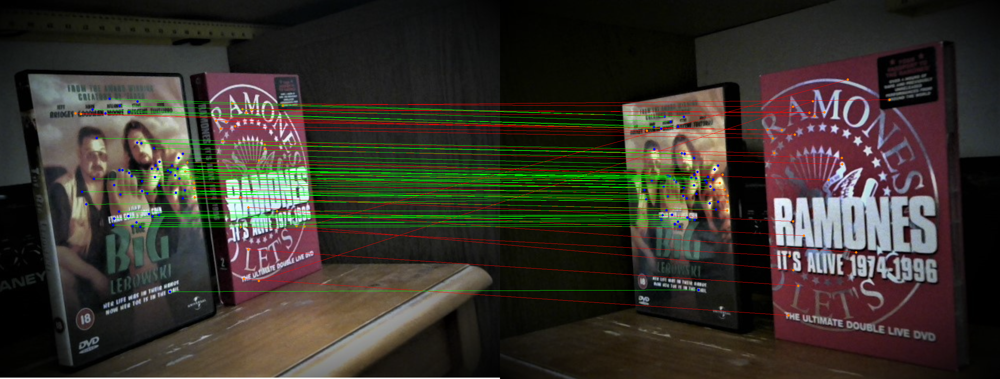

r = 0.75 |
Matches: 219 |
Inliers: 70 |
% Retained: 31.96

r = 0.90 |
Matches: 489 |
Inliers: 103 |
% Retained: 21.06

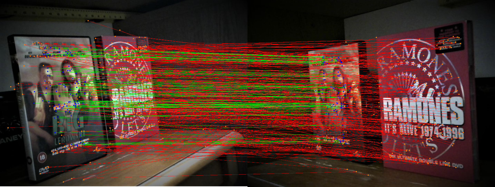

Image Pairing: uttower1.jpg and uttower2.jpg

r = 0.60 |
Matches: 306 |
Inliers: 304 |
% Retained: 99.35

r = 0.75 |
Matches: 366 |
Inliers: 354 |
% Retained: 96.72

r = 0.90 |
Matches: 485 |
Inliers: 382 |
% Retained: 78.76

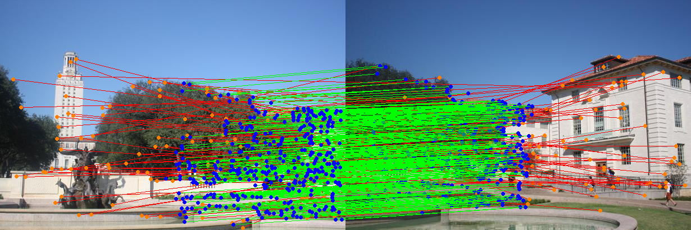

Between these two image pairs, the reasonable default for the ratio is about 0.75. If the ratio is too high, it creates too many matches and exceedingly sporadic matches that decreases the inlier retention rate significantly. At around 0.60, it could work but in certain image pairings this seems as if it would be too restrictive in the amount of matches it makes, as a majority of them remain as inliers. At a ratio threshold of 0.75, you get enough matches that there are some that are bad, but the retention rate is high enough that it is properly determining the correct homography. So to me it is adaptable enough to capture the widest range of different images.

--RANSAC Evaluation--

Inlier Threshold Test:

Image Pairing: uttower1.jpg and uttower2.jpg

threshold: 1 | matches: 366 | inliers: 307 | %: 83.88

Reprojection Error Medians:

Before RANSAC: 16.38 | After RANSAC inliers only: 0.39 | After RANSAC all: 0.46

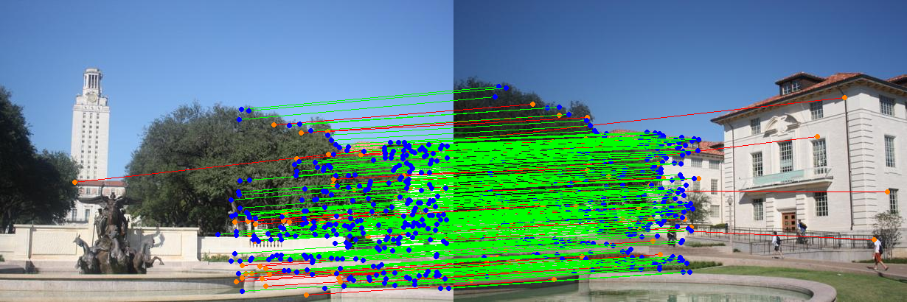

threshold: 2 | matches: 366 | inliers: 351 | %: 95.90

Reprojection Error Medians:

Before RANSAC: 16.38 | After RANSAC inliers only: 0.50 | After RANSAC all: 0.53

threshold: 5 | matches: 366 | inliers: 354 | %: 96.72

Reprojection Error Medians:

Before RANSAC: 16.38 | After RANSAC inliers only: 0.46 | After RANSAC all: 0.49

At a threshold of 1, the number of inliers is significant, there still appears to be some close matches that are not counted as inliers. When we increase the threshold to 2, there is a significant jump to 351 inliers from 307 at threshold=1. If we try a higher threshold like 5, the inliers barely increase at all. So, for this homography the ideal threshold is at least 2.

Image Pairing: dvd_left.png and dvd_right.png

threshold: 2 | matches: 219 | inliers: 37 | %: 16.89

Reprojection Error Medians:

Before RANSAC: 36.77 | After RANSAC inliers only: 0.91 | After RANSAC all: 54.08

threshold: 5 | matches: 219 | inliers: 70 | %: 31.96

Reprojection Error Medians:

Before RANSAC: 36.77 | After RANSAC inliers only: 1.51 | After RANSAC all: 54.08

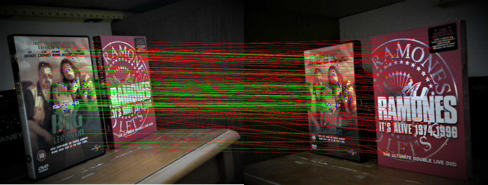

threshold: 26 | matches: 219 | inliers: 106 | %: 48.40 

Reprojection Error Medians:

Before RANSAC: 36.77 | After RANSAC inliers only: 3.06 | After RANSAC all: 62.26

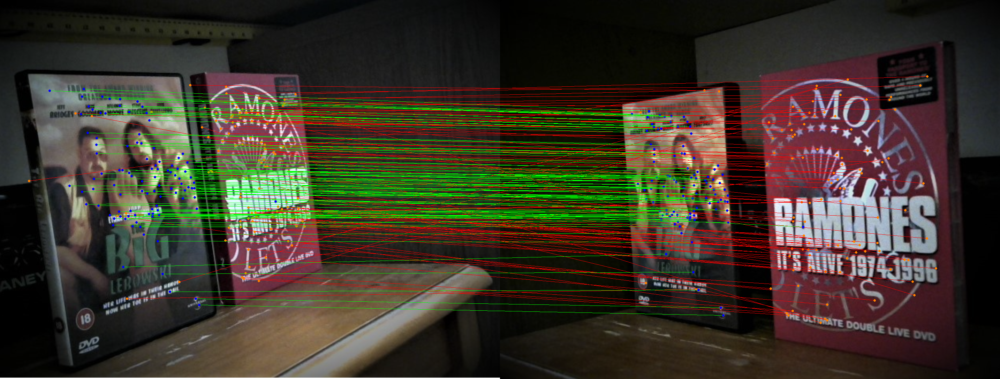

threshold: 27 | matches: 219 | inliers: 107 | %: 48.86

Reprojection Error Medians:

Before RANSAC: 36.77 | After RANSAC inliers only: 9.44 | After RANSAC all: 28.46

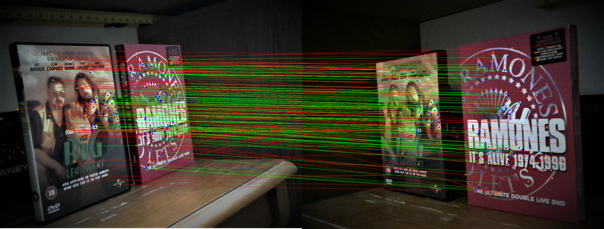

For the dvd images at a threshold of 2, there are 37 inliers, but unlike the uttower images the number of inliers continues to rise at a high rate. The inlier increase from threshold 2 to 5 is 33 and the number increase between threshold 5 and 26 is 36. So the ideal threshold is slightly higher here around 5. 
The difference between the two images is that the dvds are taken at a much different perspective than the uttower images. It also has two distinct items that can create matches. Thresholds up to 26 focus solely on The Big Lebowski dvd cover, saying all the matches on the Ramones dvd are outliers, but at threshold 27 it then takes some matches on the ramones dvd as inliers, changing the homography for any larger thresholds. The projection error for inlier sharply increases from threshold 26 to 27, but then the overall error actually decreases sharply, so overall it is more accurate, but the inliers are less.

Homography Threshold = 26:

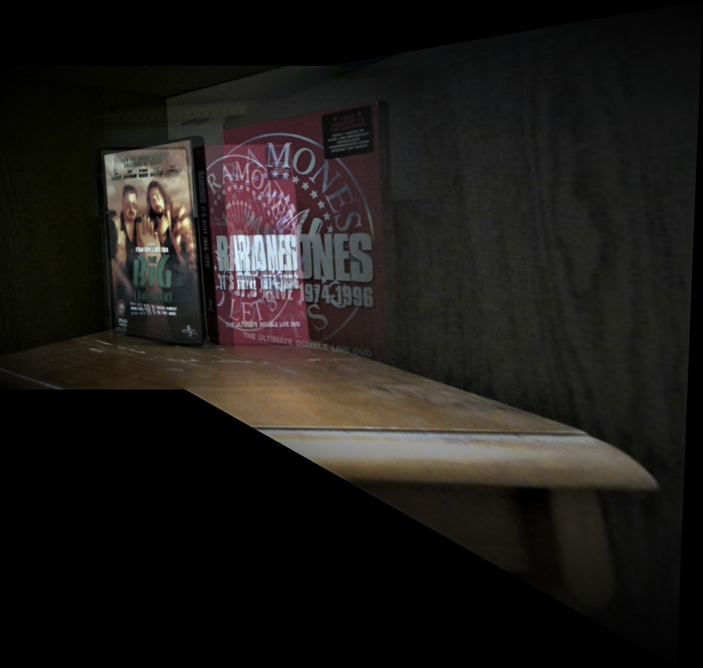

Homography Threshold = 27:

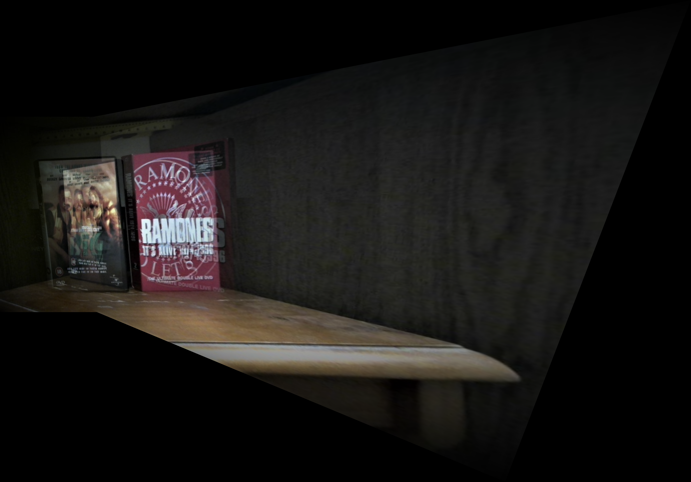

Because I wanted to take into account images like the dvds with larger changes in perspective, I set the default threshold to be 5 where most images would have the largest clear patterned increase in inliers.

RANSAC Iteration Tests:

Image Pairing: dvd_left.png and dvd_right.png

Iterations: 500 | matches: 219 | inliers: 35 | %: 15.98

Reprojection Error Medians:

Before RANSAC: 36.77 | After RANSAC inliers only: 2.63 | After RANSAC all: 60.27

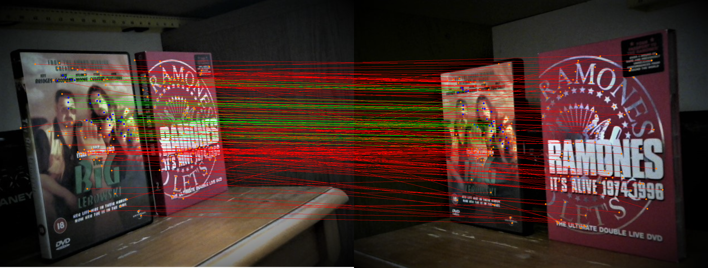

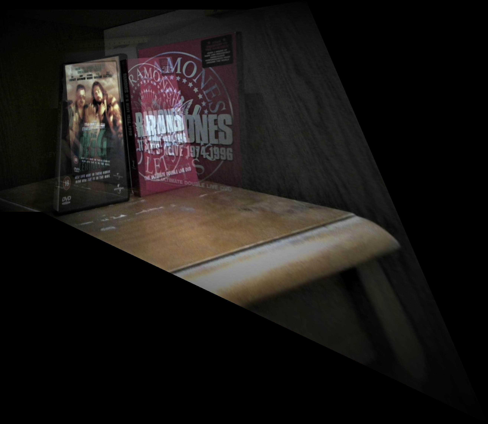

Iterations: 1000 | matches: 219 | inliers: 53 | %: 24.2

Reprojection Error Medians:

Before RANSAC: 36.77 | After RANSAC inliers only: 1.69 | After RANSAC all: 50.95

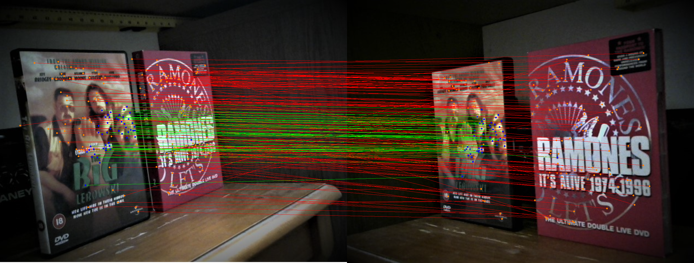

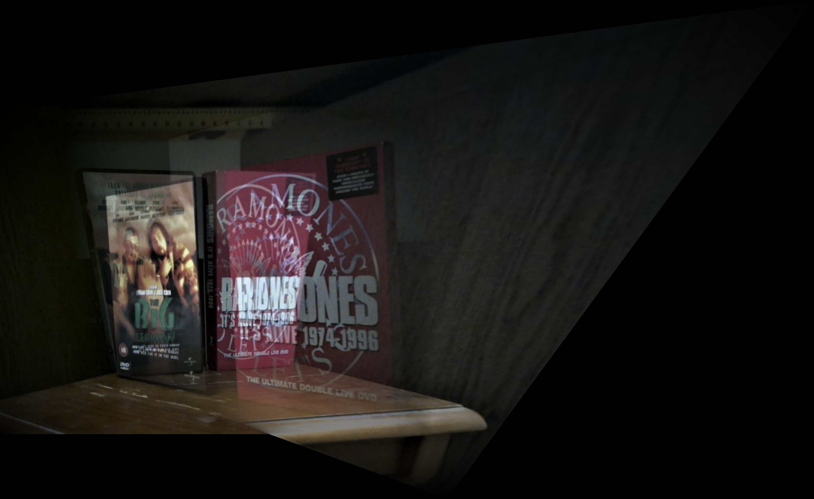

Iterations: 1500 | matches: 219 | inliers: 70 | %: 31.96

Reprojection Error Medians:

Before RANSAC: 36.77 | After RANSAC inliers only: 1.51 | After RANSAC all: 54.08

Iterations: 2000 | matches: 219 | inliers: 70 | %: 31.96

Reprojection Error Medians:

Before RANSAC: 36.77 | After RANSAC inliers only: 1.51 | After RANSAC all: 54.08

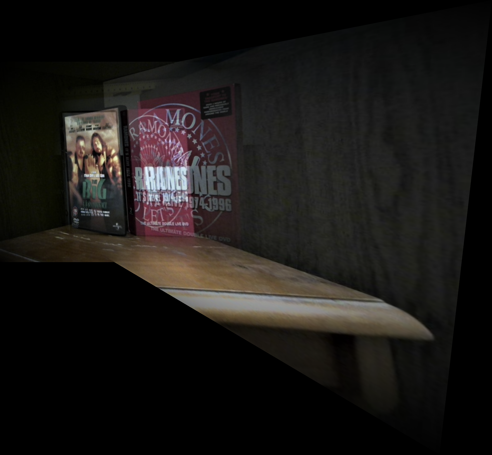

After about 1500 iterations there was no further improvement within the model. From 1500 to 2000, the median errors all stayed the same as well as the number of inliers. The appearance of the homography improved as the number of iterations increased, as did the inlier error go down. I chose 2000 iterations as the default just in case as there may be certain image pairs that required more iterations, but it isn't so much more that it is extended the runtime of the program to an extreme amount.

--Affine versus Homography--

Image Pairing: uttower1.jpg and uttower2.jpg

Affine:

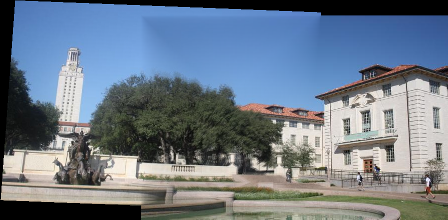

Matches: 366 | Inliers: 318 | %: 86.9

Median Reprojection Error:

Before RANSAC: 5 | After RANSAC inliers only: 3.13 | After RANSAC all: 3.30

Homography:

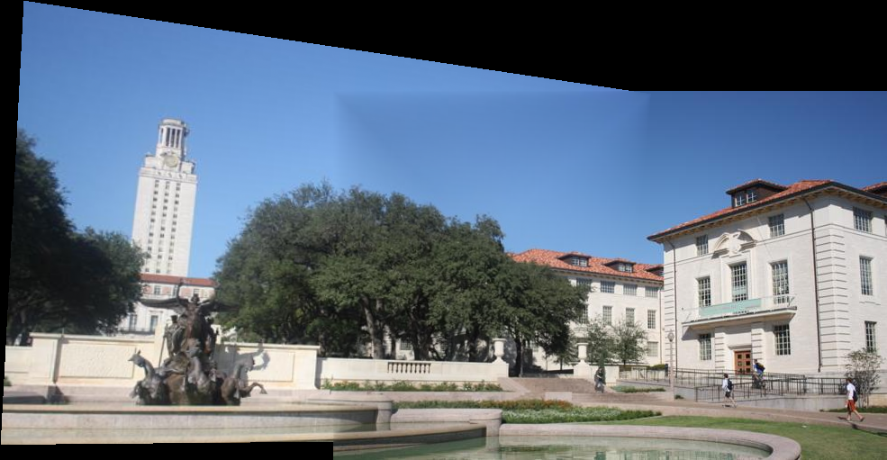

Matches: 366 | Inliers: 354 | %: 96.7

Median Reprojection Error:

Before RANSAC: 16.38 | After RANSAC: 0.46 | After RANSAC: 0.49

Image Pair: dvd_left.png and dvd_right.png

Affine:

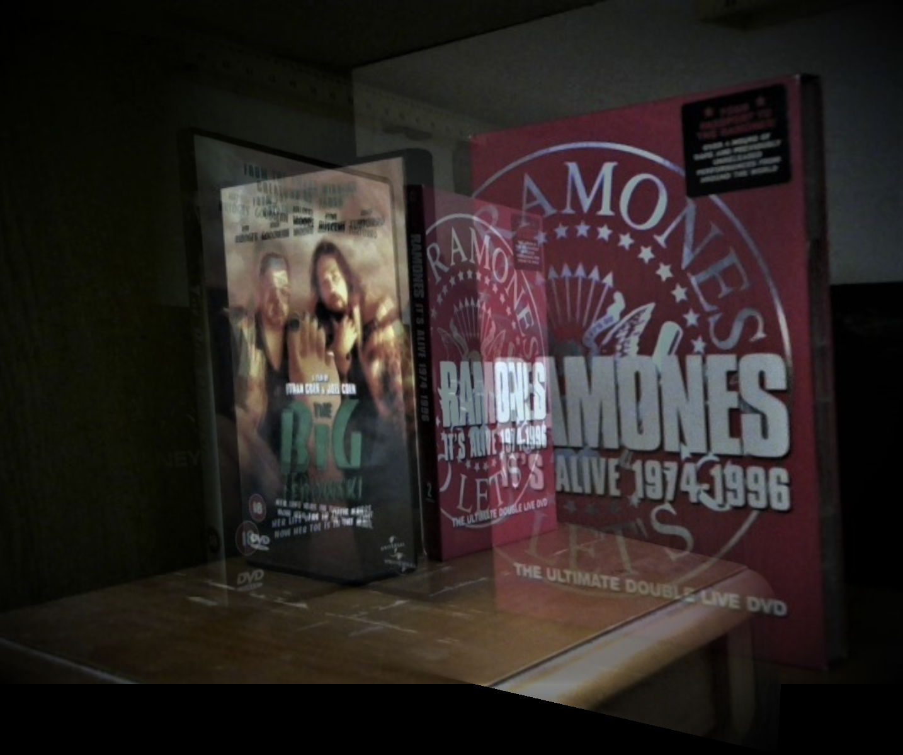

Matches: 219 | Inliers: 43 | %: 19.6

Median Reprojection Error:

Before RANSAC: 66.17 | After RANSAC: 1.75 | After RANSAC: 71.45

Homography:

Matches: 219 | Inliers: 70 | %: 32.00

Median Reprojection Error:

Before RANSAC: 36.77 | After RANSAC: 1.51 | After RANSAC: 54.08

It appears as if the homography is generally better at getting a more accurate panorama and overlay. For both image pairs, it got more inliers and it got a lower median error for both the inliers and overall. Which makes sense as it takes into account more variations in the images as opposed to a simple shift, so it can account for all of what an affine can, but an affine cannot do what a homography can. Affine only accounts for 6 degrees of freedom, so its ability to align something like the dvds is impossible to very good with different camera angles and depths, whereas a homography with 8 degrees of freedom can.

--Multiple-Image Panorama--

Multiple Images: yosemite1.jpg, yosemite2.jpg, yosemite3.jpg, yosemite4.jpg

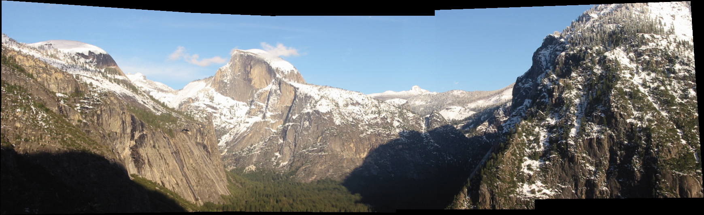

Reference Image: yosemite3.jpg

Custom Images: union1.jpeg, union2.jpeg, union3.jpeg

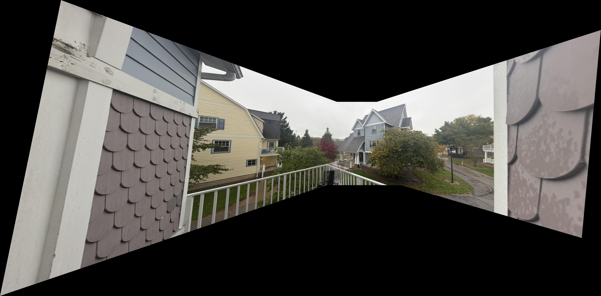

Reference Image: union2.jpeg

Blending Choices:
- The reference image used is the middle image. Every image has some shift/error to account for and choosing the middle image as the reference reduces that error as every image is half the image away from the reference.
- Feathering is used to blend the edges together. Each pixel's weight is its distance to the nearest edge of the source image plus 1. Panorama is the weighted average of all images covering that pixel.
- Inverse warping with bilinear interpolation. This is an AI addition that takes output pixels back to source pixels guarenteeing every output has a value, with no holes.

Evidence of Automatic Matching:

union1.jpeg:

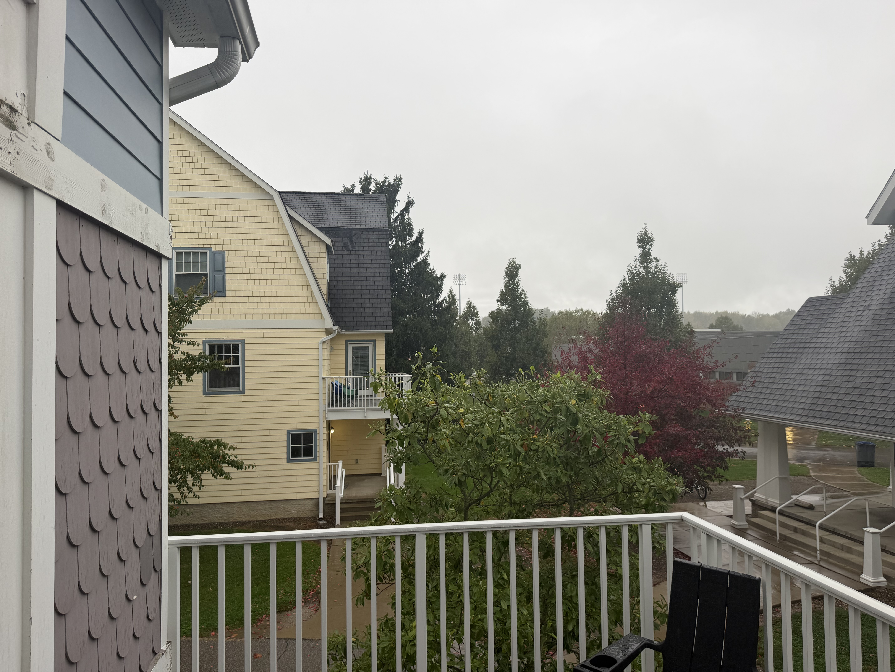

union2.jpeg:

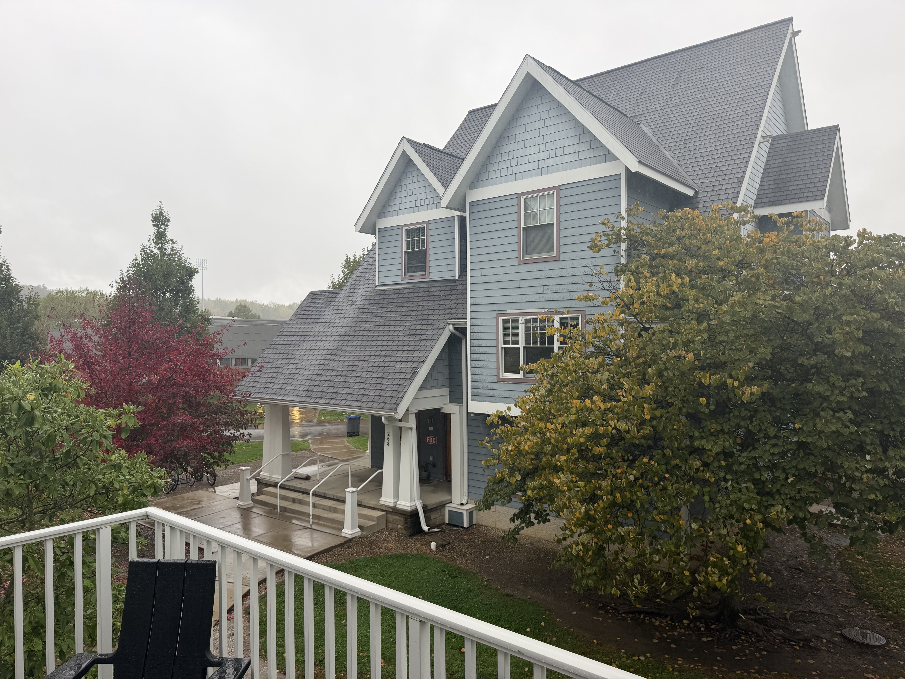

union3.jpeg:

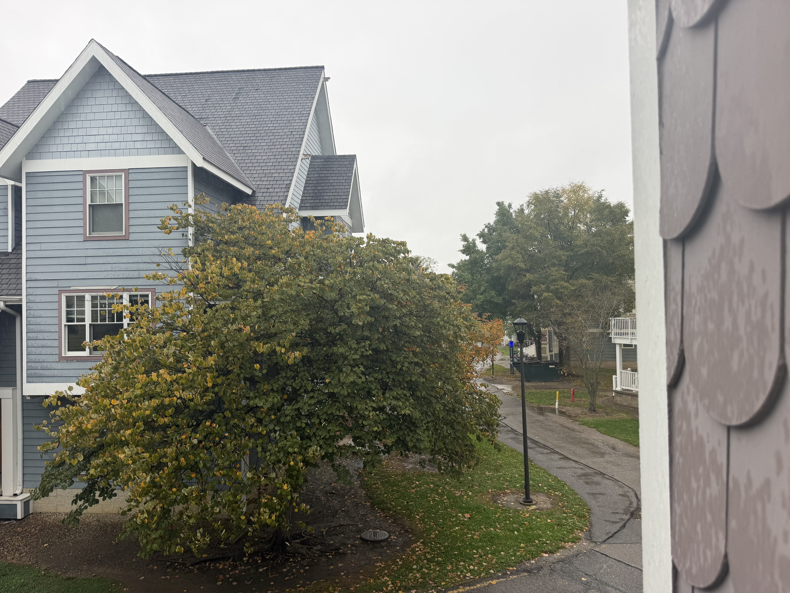

Matches of union1 and union2:

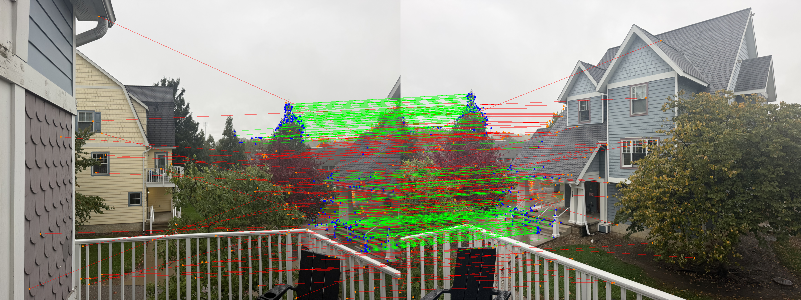

Matches: 322 | Inliers: 196 | %: 60.9

Median Reprojection Error:

Before RANSAC: 90.53 | After RANSAC inliers only: 1.29 | After RANSAC all: 3.11

Matches of union2 and union3:

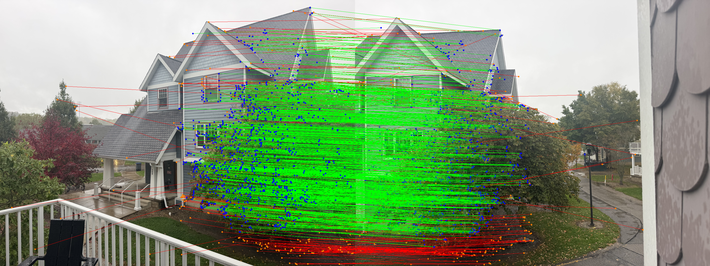

Matches: 1028 | Inliers: 1208 | %: 85.1

Median Reprojection Error:

Before RANSAC: 41.39 | After RANSAC inliers only: 1.91 | After RANSAC all: 2.18

For these photos I went on my balcony and rotated around the entirety of the view taking 3 separate pictures. 

--AI Declaration--

I utilized AI in many of the same ways in which I used on the first project. I had it help with debugging some issues/bugs that I experienced throughout the course of this project.
The biggest issue I experienced many times was a memory issue where the creation of the panorama would require a significant amount of memory resulting in the program to terminate, so I used AI to try to help me fix this issue as I was unable to get any output images. It helped rewrite some of the functions to change parts of the process into smaller chunks. Feature matching is now done in blocks, image warping in rows, blending by accumulations. It would terminate on large keypoint sets and canvases. I also had it create some helper functions to streamline some of the program process like polygon_area() and is_convex().
However, during this memory issue it went through many iterations of functions that did not work, so I had to go in, change parts, and try it again, it would terminate, I would AI debug, terminate, check things myself, and repeat. Until eventually I got to a working program.